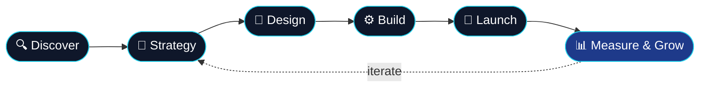

<!-- NEXGEN DMA · Organization Profile README -->

 

  

 

 

 

## 🏢 About Us

> **Nexgen DMA** is a digital agency where **marketing strategy meets engineering**.
> We help startups and businesses grow online — from brand identity and performance marketing to high-performance websites, apps and automation pipelines.

<table>
<tr>
<td width="50%" valign="top">

### 🎯 What we do
- 📈 **Performance Marketing** — SEO, SEM, paid social, analytics
- 🎨 **Brand & Creative** — identity, content, motion, campaigns
- 💻 **Web & App Development** — fast, accessible, SEO-first builds
- ⚙️ **Automation & Integrations** — CRM, workflows, AI-powered tooling
- 📊 **Data & Reporting** — dashboards that turn numbers into decisions

</td>
<td width="50%" valign="top">

### 💡 How we work
- 🧭 Strategy first, execution second
- 🚀 Ship fast, measure everything, iterate
- 🔓 Open standards & clean, documented code
- 🤝 Transparent communication, no black boxes
- 🌍 Remote-friendly, timezone-flexible team

</td>
</tr>
</table>

## 🛠️ Tech Stack

**Frontend**

**Backend & Data**

**DevOps & Tooling**

**Marketing & Growth**

## 🚀 Our Process

## 📦 Featured Work

> 🔧 Our public repositories are coming soon — starter kits, automation scripts and open-source tools we use every day.
> Watch this org or ⭐ star us to get notified.

<!-- When repos go public, replace the note above with cards like this:

-->

## 📬 Let's Talk

Have a project in mind? We'd love to hear about it.

  

© 2026 Nexgen DMA · Built with ❤️ and lots of ☕

